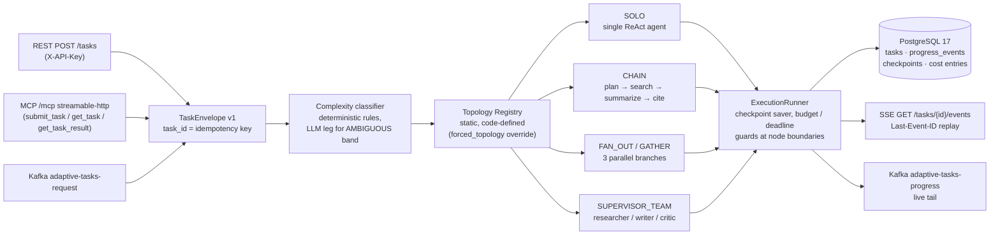

# adaptive-agent-runtime

An adaptive, durable multi-agent runtime for the JVM. It is a single Spring Boot service that accepts research tasks over three protocols (REST+SSE, MCP streamable-http, Kafka request/reply), classifies each task's complexity, routes it to one of four code-defined agent topologies, and executes it durably on PostgreSQL checkpoints: a process killed mid-task resumes from the last checkpoint on restart, and a task that runs out of budget or deadline returns its partial result instead of silently disappearing.

It is a runtime, not an agent platform. There is no web UI, no visual workflow designer, and no dynamic or config-driven graph assembly; external tools enter only through the config-driven MCP client federation (servers listed under `spring.ai.mcp.client.*`, their tools attached to every topology), and there is no auth beyond a single `X-API-Key` on the REST ingress. The topology set is static and defined in code.

## Why

Agent frameworks ship graph primitives but leave two decisions to every builder: which topology should run for a given task, and how execution survives restarts. Agent platforms answer those questions by taking over the runtime — designer UI, hosting, their own envelope format. This project occupies the gap between them: envelope in → complexity-classified topology routing → durable execution with degradation, behind plain protocol endpoints.

Concretely, every incoming `TaskEnvelope` is scored by deterministic rules — the LLM classification leg runs only for the ambiguous band, with rule fallback — and mapped to `SOLO`, `CHAIN`, `FAN_OUT`/`GATHER` or `SUPERVISOR_TEAM`; a `forced_topology` field in the envelope body overrides the classifier from any ingress. Execution runs under a Postgres checkpoint saver (`threadId = task_id`), and budget/deadline guards degrade each topology according to a documented matrix that never drops partial results.

## Architecture



Stack: Java 25, Spring Boot 4.1.1, Spring AI 2.0.1, LangGraph4j 1.9.1 (combination verified in the [SPIKE.md](SPIKE.md) integration spike), PostgreSQL 17, Apache Kafka 3.9 (KRaft single node), micrometer-tracing with OTLP export to Jaeger.

## Quickstart

Requires Docker with the compose plugin.

```bash
cp .env.example .env      # then set RUNTIME_API_KEY and POSTGRES_PASSWORD
docker compose up -d --wait
./scripts/smoke.sh
```

- [`cp .env.example .env`](.env.example) — copies the environment template; fill in the two required values (`RUNTIME_API_KEY`, `POSTGRES_PASSWORD`). The smoke script fails fast when the file or either value is missing.
- `docker compose up -d --wait` — healthcheck-gated startup of the [compose.yaml](compose.yaml) stack (app, postgres, kafka, jaeger). [`./scripts/smoke.sh`](scripts/smoke.sh) runs this same command itself and tears the stack down in an exit trap, so the standalone `up` is only needed when you want the stack to stay alive afterwards.
- `./scripts/smoke.sh` — submits a SOLO-band research envelope via `POST /tasks` with `X-API-Key`, follows the SSE event stream to the terminal `TASK_COMPLETED` event, and asserts the final task state is `SUCCEEDED` with a non-empty result.

By default the stack is hermetic: the `fixture-model` Spring profile registers a deterministic fixed-text model and fixture-backed search tools — no LLM key, no outbound network. Wiring a real OpenAI-compatible endpoint (or the optional `ollama` compose profile) is documented in `.env.example`.

Tracing: while the stack is up, open the Jaeger UI at http://localhost:16686 and select service `adaptive-agent-runtime`. Every node execution and tool call is a span, and progress event payloads carry the `traceId`.

## Demo

[`scripts/demo.sh`](scripts/demo.sh) walks the runtime end to end over the compose stack: three research tasks of rising complexity via REST+SSE — `SOLO`, then `FAN_OUT`/GATHER (watch the three `branch-*` node starts interleave), then `SUPERVISOR_TEAM` (the researcher → writer → critic loop over two critic rounds) — followed by a Kafka request/reply roundtrip with the console producer/consumer (the reply ACK shows the `forced_topology` `OVERRIDE` decision) and a raw-curl MCP streamable-http session (`initialize` → `submit_task` → `get_task`). It runs the hermetic `fixture-model` profile — no LLM key needed — and never prints credential values.

The recorded session lives at [docs/demo.cast](docs/demo.cast); play it back with `asciinema play docs/demo.cast`.

<!-- asciinema.org embed placeholder: upload docs/demo.cast at https://asciinema.org and replace this comment with
     [](https://asciinema.org/a/xxxx) -->

## Protocols

Three ingresses map onto the same canonical `TaskEnvelope` JSON body. `task_id` is the idempotency key on every ingress, and no header can override identity or topology.

- **REST + SSE** — `POST /tasks` (202 with `task_id`; a duplicate `task_id` returns the existing task), `GET /tasks/{id}`, and `GET /tasks/{id}/events` with `Last-Event-ID` replay; `X-API-Key` required on `/tasks/**`, failures mapped as RFC 7807 problem+json.
- **MCP** — streamable-http on the same servlet port at `/mcp`, auth-exempt; tools `submit_task`, `get_task`, `get_task_result`; client errors surface as tool error results, never HTTP 500.
- **Kafka** — request/reply: a record on `adaptive-tasks-request` gets an immediate submission ACK on `adaptive-tasks-reply` (the listener never blocks on task completion), progress is a live tail on `adaptive-tasks-progress`, and poison envelopes are copied to `adaptive-tasks-request-dlt`.
- **MCP client (outbound federation)** — external MCP servers listed under `spring.ai.mcp.client.*` in `application.yml` (streamable-http / sse / stdio); their tools are federated into every topology alongside the workload tools. Off by default (commented example in the config) — the hermetic stack opens no outbound sessions.

Full mapping tables, the auth matrix, and Kafka/SSE consumption notes: [docs/ENVELOPE.md](docs/ENVELOPE.md). Client result-consumption patterns (polling vs progress-topic tail): [bench/README.md](bench/README.md).

## Adaptive routing

The `RuleScorer` scores prompt length, `breadth_hint`, and deadline tightness:

| Score | Band | Topology |
|---|---|---|
| ≤ 0 | `CLEAR_SIMPLE` | `SOLO` |
| 1–19 | `AMBIGUOUS` | LLM classification leg (rule fallback) → `CHAIN` |
| ≥ 20, breadth < 4 | `CLEAR_COMPLEX` | `FAN_OUT` |
| ≥ 20, breadth ≥ 4 | `CLEAR_COMPLEX` | `SUPERVISOR` |

`forced_topology` in the envelope body overrides the classifier from any ingress. The 12-task demo set, its expected routing distribution, and a contradicting-hints QA case are documented in [docs/TASKS.md](docs/TASKS.md).

## Skills

Optional instruction packages the agents can consult at runtime. Point `runtime.skills.path` (env `RUNTIME_SKILLS_PATH`) at a folder of skill packages — each a `SKILL.md` with a small frontmatter (`name:`, `description:`) and a markdown instruction body:

```
skills/
  deep-research/SKILL.md
  fact-checking/SKILL.md
```

When set, every topology gains two model tools — `list_skills` (catalog: name — description) and `load_skill(name)` (full instructions for the model to follow) — next to the workload tools. The folder is scanned once at startup; malformed or duplicate skills fail the boot with the offending file named. Absent (default): no skills bean, no extra tools, hermetic behavior unchanged.

## Benchmark

The `bench` module runs the 12 demo tasks across all four topologies (`forced_topology` override), N ≥ 3 runs each, and reports median latency, token-priced cost, and rubric-scored quality; a stub profile exercises the full 4 × 12 × 3 matrix in CI without a model. [BENCHMARK.md](BENCHMARK.md) currently carries a **NOT RUN** status: no LLM backend with sustained throughput was available in this environment at commit time, so the file records the pinned profile and the exact reproduction command (`mvn test -pl bench -Pbenchmark-real`) instead of fabricated numbers.

## Durability and degradation

- **Checkpointed execution** — graphs compile with a Postgres checkpoint saver (`threadId = task_id`); a node failure maps to `FAILED` with the last checkpoint retained.
- **Resume after kill** — `StartupRescan` resumes tasks left `RUNNING` by a dead process from their last checkpoint at boot; a deadline that expired during downtime finalizes as `DEADLINE_EXCEEDED` without invoking the graph.
- **Idempotency** — a duplicate `task_id` (same payload, any ingress, including Kafka redelivery) resolves to the existing task; there is no second execution and no 409 path.
- **Budget and deadline guards** — checks at every node boundary plus a periodic `RunningTaskSweep` that finalizes runs hung mid-node; per-topology degradation (`SOLO` stop, `CHAIN` stop-at-stage, `FAN_OUT` reduced width, `SUPERVISOR` finish-with-partial) always keeps the partial result: [docs/DEGRADATION.md](docs/DEGRADATION.md).

## Project layout

| Module | Contents |
|---|---|
| `core/` | `TaskEnvelope` v1 contract, rule scorer + LLM classifier leg, `TaskStore` state machine, progress event log |
| `topologies/` | static `TopologyRegistry`, the four LangGraph4j graphs, checkpointed `ExecutionRunner`, budget/deadline guards, cost tracking, `RunningTaskSweep` |
| `ingress/` | REST+SSE, Kafka request/reply + progress publishing, MCP streamable-http server tools |
| `workload/` | research reference workload: fixture-first search/fetch/cite tools, 12-task demo set with recorded fixtures |
| `bench/` | cross-topology benchmark harness and client consumption patterns |
| `app/` | the single Spring Boot deployable that assembles everything |
| `spike/` | wave-0 integration spike (verified version combination, kept as reference) |

## Documentation

- [SPIKE.md](SPIKE.md) — wave-0 integration spike: verified version combo, saver DDL mechanism, checkpoint-resume recipe
- [docs/ENVELOPE.md](docs/ENVELOPE.md) — `TaskEnvelope` v1 schema, protocol mappings, auth matrix, Kafka/SSE consumption notes
- [docs/DEGRADATION.md](docs/DEGRADATION.md) — budget/deadline degradation matrix per topology
- [docs/TASKS.md](docs/TASKS.md) — 12-task demo set, classification bands, expected routing matrix
- [BENCHMARK.md](BENCHMARK.md) — benchmark status and reproduction instructions
- [bench/README.md](bench/README.md) — client result-consumption patterns and harness usage
